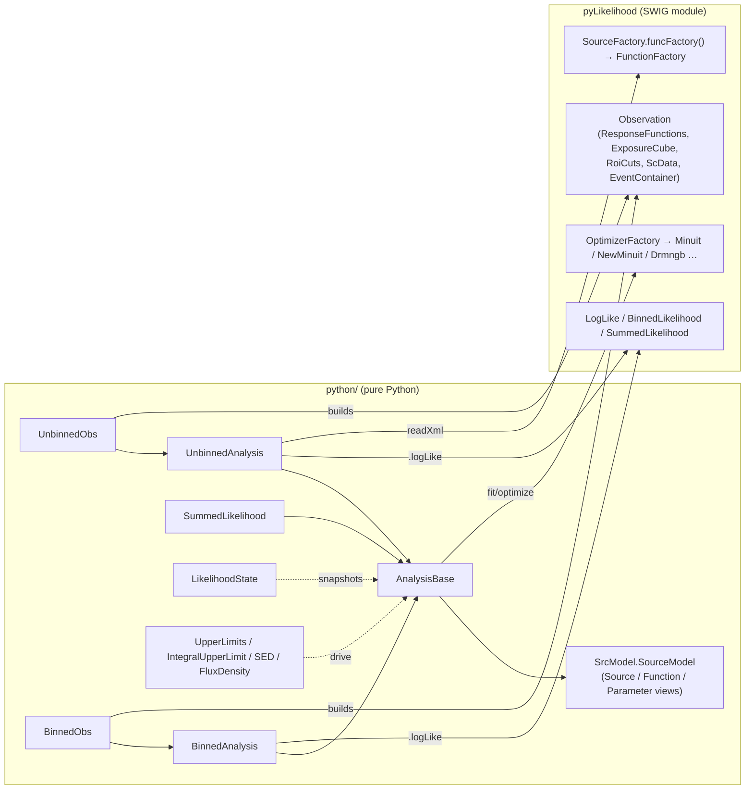

# pyLikelihood Architecture

**pyLikelihood** is how Python users run Fermi-LAT likelihood analysis. It
has two parts:

1. **`pyLikelihood`**, a SWIG module (`src/pyLikelihood.i` →
   `_pyLikelihood.so` + generated `pyLikelihood.py`). It wraps 89
   `Likelihood` headers and also the parts of `optimizers`, `astro`,
   `st_app`, `dataSubselector`, `healpix`, `map_tools`, `st_facilities` and
   `irfs` that the Likelihood API passes around. For most Python users this
   module is **the only way into the C++ stack**. `fermipy` (an external
   package, not in this repository) is built on it too.
2. **A pure-Python layer** (`python/*.py`). It wraps the raw `LogLike`
   objects in friendlier classes: `UnbinnedObs`/`UnbinnedAnalysis`,
   `BinnedObs`/`BinnedAnalysis`, `SummedLikelihood`, `LikelihoodState`,
   `UpperLimits`, `IntegralUpperLimit`, `SED` and `FluxDensity`.

The Doxygen pages in `src/mainpage.h` and `src/pyLikelihood.h` (a
tutorial) date from the DC1 era. They describe `irfs='DC1A'` defaults, the
SwigPolicy package and HippoDraw plotting. Treat them as history and use
the code as the source of truth.

Deep dives in this directory:
- [swig-interface.md](swig-interface.md): what is wrapped from which
  package, every `%extend` helper, typemaps, exception mapping and SWIG
  version constraints.
- [python-layer.md](python-layer.md): the Python classes, the analysis
  workflow, and the state of each module (which still work and which are
  dead).

## Purpose and scope

**Does:**
- Build one SWIG extension module that exposes `Likelihood::LogLike` and
  its subclasses (`BinnedLikelihood`, `SummedLikelihood`, `Composite2`,
  `CompositeLikelihood`, `OptEM`), the source/spectral model classes, the
  observation classes (`Observation`, `ResponseFunctions`, `ExposureCube`,
  `RoiCuts`, `ScData`, `EventContainer`, `CountsMap`, …) and the optimizer
  framework.
- Add Python-only conveniences to the C++ classes through `%extend`:
  downcasts (`PointSource.cast`, `SpatialMap.cast`, `Minuit.cast`, …),
  `LogLike.initOutputStreams`, `LogLike.enableFPE`, `StApp.parGroup` (read
  a tool's par file), `ResponseFunctions.load_with_event_types`, and
  others. See [swig-interface.md](swig-interface.md#extend-helpers).
- Accept `str`, `bytes` and `os.PathLike` (`pathlib.Path`) wherever a C++
  `std::string` is expected (added in 65657a8, ScienceTools issue #74).
- Provide the Python analysis classes that run the standard workflow:
  build an observation, load an XML model, fit, compute TS, upper limits
  and SEDs, and write the model back to XML.

**Does not:**
- Implement any likelihood physics. Every number comes from `Likelihood`
  (see `src/Likelihood/doc/architecture/`), and every minimizer from
  `optimizers` (see `src/optimizers/doc/architecture/`).
- Provide gt-tools. It builds no executables. It reads `gtlike.par` only
  through the convenience functions `unbinnedAnalysis()` and
  `binnedAnalysis()`.
- Prepare data. Source maps, livetime cubes and exposure maps come from
  the `Likelihood` tools (`gtsrcmaps`, `gtltcube`, `gtexpcube2`, …), and
  event selection comes from `dataSubselector`.
- Wrap `irfs` beyond `IEfficiencyFactor` and a small `Aeff` helper. The
  full IRF interface for Python is `pyIrfLoader`, built by `irfs`.

## Position in the system

### Boundary with `Likelihood`

`Likelihood` owns the C++ model: `LogLike`, sources, source maps,
exposure, the XML model format and the `gtlike` tool. pyLikelihood owns
only:
- **which** Likelihood headers Python can see, and in what order SWIG
  parses them (`src/pyLikelihood.i`)
- the `%extend` helper methods
- the Python classes in `python/`

A change to a wrapped Likelihood header changes the Python API on the
next build, with no edit here. Adding a Likelihood class to Python needs a
`#include` **and** a `%include` in `pyLikelihood.i`, placed after every
header it depends on (see [Extension points](#extension-points)).

One coupling needs manual upkeep. `BinnedAnalysis.BinnedConfig(**kwargs)`
repeats all 18 constructor defaults of `Likelihood::BinnedLikeConfig` and
passes them **positionally**. They match at this commit. If a parameter
is inserted into the C++ constructor, the Python call silently shifts
every value after it.

`Likelihood`'s regression suite
(`src/Likelihood/src/test/likelihood_test_suite/`) is written **in
Python against this package** (`BinnedAnalysis`, `UnbinnedAnalysis`,
`IntegralUpperLimit`, `LikelihoodState`). In practice it is the main
functional test of pyLikelihood (see [Build and test](#build-and-test)).

### Dependencies

| Direction | Package | Why |
|-----------|---------|-----|
| Depends on | `Likelihood` | Linked `PRIVATE`. 89 headers are `%include`d. This is the reason the package exists. |
| Depends on | `irfs` (`irfInterface`, `irfLoader`) | Linked `PUBLIC`. `%include irfInterface/IEfficiencyFactor.h`. `pyLikelihood/Aeff.h` uses `irfLoader::Loader_go` and `IrfsFactory`. Loading `libirfLoader` reads the CALDB at import time (see gotchas). |
| Depends on | `optimizers` | 12 headers `%include`d: `Parameter`, `Function`, `FunctionFactory`, `Optimizer`, `OptimizerFactory`, `Minuit`, `NewMinuit`, `Mcmc`, `Statistic`, `FunctionTest`, `Arg`, `dArg`. Reached through `Likelihood`'s PUBLIC link. |
| Depends on | `astro` | `SkyDir`, `SkyProj`, `HealpixProj`, `ProjBase`, `JulianDate`, `SolarSystem` wrapped. Through `Likelihood` (PUBLIC). |
| Depends on | `st_app` | `StApp`, `AppParGroup` wrapped; `StAppInterface` (defined inline in the `.i`) lets Python open a tool's par file. Through `Likelihood` (PUBLIC). |
| Depends on | `st_stream` | `LogLike.initOutputStreams` calls `OStream::initStdStreams` and `SetMaximumChatter`. Header only; reached transitively through `st_app`. |
| Depends on | `st_facilities` | `FitsImage`, `Util` wrapped, plus `%extend` helpers. **Not linked directly**: `Likelihood` links it `PRIVATE`, so the symbols resolve at load time through `libLikelihood`'s own dependencies. |
| Depends on | `dataSubselector` | `CutBase`, `BitMaskCut`, `Cuts` wrapped. `UnbinnedObs`/`BinnedObs` call `Cuts(...).CALDB_implied_irfs()` for `irfs='CALDB'`. |
| Depends on | `healpix` | `CosineBinner` wrapped (used with `map_tools::Exposure.data`). |
| Depends on | `map_tools` | `Exposure`, `SkyImage` wrapped. |
| Depends on | CLHEP | `Util.setRandomSeed`/`Util.shoot` (`%extend`) call `HepRandom`/`RandFlat`. Not linked directly; `Likelihood` links `CLHEP::RandomS` `PRIVATE`. |
| Depends on | Python 3 + SWIG | `Python3::Python` (PRIVATE), `swig_add_library`. Python modules also need `numpy`, `scipy`, `matplotlib` and `pyyaml` at runtime (see [python-layer.md](python-layer.md#runtime-python-dependencies)). |
| Used by | `pyBurstAnalysisGUI` | `GtBurst` imports `UnbinnedAnalysis`, `BinnedAnalysis`, `UpperLimits`, and `pyLikelihood` itself for `SkyDir`, `JulianDate`, `SolarSystem`, `SkyProj`, `PointSource` and `SourceFactory.funcFactory`. |
| Used by | `pyExposure` | `python/flux_lc.py` uses `pyLike.dArg` and `pyLike.SourceFactory_funcFactory()`. That flat name no longer exists in SWIG ≥ 4.1 builds (see gotchas). |
| Tests only | `Likelihood` | `likelihood_test_suite/scripts/*.py` (not run by CI). |
| Tests only | `sane` | `python/tests/BinnedLikelihood_test.py` imports `BinnedAnalysis`. |
| External | `fermipy` | Imports `pyLikelihood`, `BinnedAnalysis`, `SummedLikelihood` (not in this repo; not checked here). |

**CMake vs. use.** The only direct links are `irfInterface`, `irfLoader`
(PUBLIC), `Likelihood` and `Python3::Python` (PRIVATE). Everything else in
`depends_on` comes through `Likelihood`'s PUBLIC link interface
(`st_app`, `astro`, `dataSubselector`, `optimizers`, `healpix`,
`map_tools`) or only through its PRIVATE links (`st_facilities`, CLHEP
Random). The module calls code in the second group directly, so it relies
on how the runtime loader resolves symbols. A future change that drops
`st_facilities` from `Likelihood`'s link line would leave `_pyLikelihood.so`
with unresolved symbols at import time. `irfLoader`'s PUBLIC link is
broader than needed, because nothing links against the SWIG module.

`docs/architecture/dependency-layers.md` lists pyLikelihood as depending
on `Likelihood, irfs`. That is the direct link set. Through SWIG the module
exposes types from nine Fermi packages (table in
[swig-interface.md](swig-interface.md#what-is-wrapped-from-where)).

## Key abstractions



| Layer | Types | Role |
|-------|-------|------|
| **Observation** | `UnbinnedObs`, `BinnedObs` | Read the data products and build the C++ `Observation` (response functions, livetime cube, exposure, ROI cuts, spacecraft data, events or counts map). They keep the C++ helper objects alive as attributes (`_respFuncs`, `_expCube`, …), because `Observation` holds only references. `__getattr__` forwards to `observation`. |
| **Analysis** | `UnbinnedAnalysis`, `BinnedAnalysis` (subclasses of `AnalysisBase`) | Own a C++ `LogLike` (`self.logLike`) built from the observation and an XML model. Provide `fit`, `optimize`, `Ts`, `flux`/`fluxError`, `freeze`/`thaw`, `par_index`, `writeXml`, priors, `plot`. |
| **Model view** | `SrcModel.SourceModel`, `Source`, `Function`, `Parameter` | Python mirror of the C++ model with a single flat parameter index. `like[i]` and `like.model[i]` are the i-th parameter across all sources. Changing a parameter through the view marks the source as modified; `syncParams` pushes the change to C++. |
| **Joint fits** | `SummedLikelihood`, `Composite2`, `CompositeLikelihood` | Wrap the C++ composite likelihoods. `SummedLikelihood` adds independent data sets that share a model (for example PSF event types). `Composite2` ties chosen parameters across components. `CompositeLikelihood` stacks one source across ROIs. |
| **State** | `LikelihoodState` | Copies every `optimizers::Parameter` (value, bounds, scale, free flag, error) and the covariance, and restores them later. Used inside `Ts`, `UpperLimits` and `SED`. |
| **Derived results** | `UpperLimits.UpperLimit`, `IntegralUpperLimit.calc_int`/`calc_chi2`, `SED.SED`, `FluxDensity.FluxDensity` | Profile-likelihood and Bayesian upper limits, band-by-band SEDs, and dN/dE with 1σ errors from the covariance matrix. |

Details and the status of each module are in
[python-layer.md](python-layer.md).

## Data flow and control flow

### Import

```
import pyLikelihood
  → fermitools.pth has put site-packages/fermitools and $PREFIX/lib on sys.path
  → pyLikelihood.py (SWIG-generated) imports _pyLikelihood from $PREFIX/lib
  → dlopen pulls in libLikelihood, libirfLoader, … ; static initializers run
      irfLoader's Registrar constructs latResponse::IrfLoader → reads $CALDB
      (throws → std::terminate if CALDB is not set up; see gotchas)
```

### A typical unbinned fit

```python
from UnbinnedAnalysis import UnbinnedObs, UnbinnedAnalysis
obs  = UnbinnedObs('ft1.fits', 'ft2.fits', expMap='expmap.fits',
                   expCube='ltcube.fits', irfs='CALDB')
like = UnbinnedAnalysis(obs, 'model.xml', optimizer='NewMinuit')
like.fit(verbosity=0, covar=True)      # returns -logL
like.Ts('MySrc')
like.freeze(like.par_index('MySrc', 'Index'))
like.writeXml('fit.xml')
```

Inside:
1. `UnbinnedObs.__init__` checks DSS cut consistency
   (`AppHelpers.checkCuts`/`checkExpMapCuts`/`checkTimeCuts`). For
   `irfs=None` or `'CALDB'` it asks `dataSubselector::Cuts` for the IRF
   name implied by the event file. It loads the response functions **per
   event type** (`load_with_event_types`), reads the exposure map and
   livetime cube, builds `Observation`, then reads FT2 (limited to the
   ROI time range) and FT1.
2. `UnbinnedAnalysis.__init__` creates `pyLike.LogLike(observation)`, calls
   `initOutputStreams()` (so C++ `st_stream` output appears), `readXml`
   with the module-level `FunctionFactory`, and `computeEventResponses()`.
   It wraps the result in `SourceModel`.
3. `fit()` (`AnalysisBase._errors`): `syncParams`, then
   `OptimizerFactory.instance().create(optimizer, logLike)`,
   `find_min(verbosity, tol, tolType)` and `getUncertainty()`. With
   `covar=True` it also calls `covarianceMatrix()`. It writes errors back
   to the free parameters and returns `-logLike.value()`.
4. `Ts(src)`: snapshots `LikelihoodState`, deletes the source, renormalizes
   (or re-optimizes if `reoptimize=True`), takes
   `2·(logL1 − max(logL0, …))`, re-adds the source and restores state.

The binned path is the same, except that `BinnedObs` reads a **source-maps
file** (output of `gtsrcmaps`) and a binned exposure map, and
`BinnedAnalysis` constructs `BinnedLikelihood(countsMap, observation,
BinnedConfig, srcMaps, weightMap)`. The full API workflow is in
[python-layer.md](python-layer.md#analysis-workflow).

## Public interfaces

- **Python, SWIG module:** `import pyLikelihood` (conventionally
  `as pyLike`). The authoritative list of wrapped headers is in
  [swig-interface.md](swig-interface.md#what-is-wrapped-from-where).
- **Python, pure modules** (installed flat into
  `site-packages/fermitools/`, importable top-level): `AnalysisBase`,
  `UnbinnedAnalysis`, `BinnedAnalysis`, `SummedLikelihood`, `Composite2`,
  `CompositeLikelihood`, `SrcModel`, `LikelihoodState`, `UpperLimits`,
  `IntegralUpperLimit`, `SED`, `FluxDensity`, `MPLPlot`, plus legacy
  modules (`SrcAnalysis`, `HippoPlot`, `RootPlot`, `SimpleDialog`,
  `ST_Version`, `package_paths`, `test_model`). Their status is in
  [python-layer.md](python-layer.md#module-status).
- **C++ headers:** `pyLikelihood/Aeff.h`, `pyLikelihood/enableFPE.h` are
  installed to `include/fermitools/pyLikelihood`. They exist only to be
  wrapped and have no C++ users (see gotchas).
- **Applications:** none.
- **Par files:** none of its own. `unbinnedAnalysis()` and
  `binnedAnalysis()` read and **save** `gtlike.par` through
  `StApp.parGroup('gtlike')`. See `src/ape/doc/architecture/parameter-files.md`.
- **Files read:** FT1, FT2, exposure maps, livetime cubes, source maps,
  binned exposure maps, weight maps, XML source models (all through
  `Likelihood`). **Written:** XML models (`writeXml`), counts spectra
  (`writeCountsSpectra`), model maps (`BinnedAnalysis.writeModelMap`),
  `state()` scripts, priors YAML (`writePriorsYaml`), SED text and PNG.
- **Environment variables:** none read directly. Importing the module
  needs the conda activation variables (`CALDB`, `CALDBCONFIG`,
  `CALDBALIAS`, `FERMI_INST_DIR`; see "Runtime environment" in
  `docs/architecture/README.md`). `MPLBACKEND` affects `MPLPlot`/`SED`
  plotting.

## Build and test

- **CMake:** `include(UseSWIG)`, `swig_add_library(pyLikelihood LANGUAGE
  python SOURCES src/pyLikelihood.i)` with `CPLUSPLUS ON`,
  `SWIG_USE_TARGET_INCLUDE_DIRECTORIES TRUE` and
  `CMAKE_SWIG_FLAGS -w362 -w389 -w401 -w402 -w503 -w509` (silences
  operator-renaming and base-class warnings). On macOS it adds `-bundle
  -flat_namespace`. The top level requires `SWIG 3.0.1` and Python ≥ 3.7.
  The conda recipe and the develop environments pin **`swig>=4.1`** and
  **Python 3.12**; see [swig-interface.md](swig-interface.md#swig-version-constraints)
  for why ≥ 4.1 matters.
- **`TRAP_FPE`** is defined globally by the top-level `CMakeLists.txt` on
  every platform except Apple. It decides whether `enableFPE()` works or
  throws.
- **Install:**
  - `_pyLikelihood.so` goes to `$PREFIX/lib` (the `LIBRARY DESTINATION
    lib` of the module target)
  - the generated `pyLikelihood.py` and every file in `python/` go to
    `site-packages/fermitools/`
  - `pyLikelihood/*.h` go to `include/fermitools/pyLikelihood`

  The top-level build writes `fermitools.pth` containing `fermitools` and
  `../../../lib/`, so both directories are on `sys.path`. That is why
  `import pyLikelihood` and `import UnbinnedAnalysis` work as top-level
  imports.
- **Size:** the generated wrapper is large. In a 2026 build `_pyLikelihood.so`
  is about 48 MB and `pyLikelihood.py` about 11,800 lines, against a
  712-line `.i` file.
- **Tests in this package:** none. `python/test_model.py` is a manual
  derivative checker for spectral functions. It is installed, but nothing
  runs it.
- **`recipe/tests/ST-unit-test`** (run by CI) only checks that modules
  import. In the default `unitTestsWithoutRoot` list:
  `check_import_AnalysisBase`, `BinnedAnalysis`, `CompositeLikelihood`,
  `FluxDensity`, `LikelihoodState`, `pyLikelihood`, `SummedLikelihood`
  and `UnbinnedAnalysis`. The check functions catch only `ImportError`; an
  import that aborts the process (no CALDB) takes the harness down with
  it. There is no `check_test_pyLikelihood_output` and no `outref`.
- **Functional coverage** comes from `Likelihood`'s
  `src/test/likelihood_test_suite/likelihoodTestSuite.py`. It runs about
  14 Python scripts (binned and unbinned fits, freeze/thaw, restore,
  delete source, EBL, upper limits), compares their printed output with
  `key_data/`, and checks time and memory. Inputs come from
  `$CONDA_PREFIX/share/fermitools/data/Likelihood/outref/`, installed by
  the separate `fermitools-test-scripts-data` package. It is **not run by
  CI**. `sane/python/tests/BinnedLikelihood_test.py` also uses
  `BinnedAnalysis`.
- **Legacy files:** `SConscript`, `pyLikelihoodLib.py` (SCons) and
  `azure-pipelines.yml` (old Azure CI). `src/pyLikelihood.in` is a 2010
  copy of the interface file that nothing uses.

## Invariants and gotchas

**Import and environment**
- **Importing `pyLikelihood` without conda activation aborts Python.**
  Loading the module loads `libirfLoader`, whose static initializer reads
  the CALDB. If `CALDB`/`CALDBCONFIG` are missing it throws during static
  initialization, so `std::terminate` kills the interpreter with
  `terminate called after throwing … File not found:
  /refdata/fermi/caldb/software/tools/alias_config.fits`. No Python
  exception is raised (confirmed at runtime). See `src/irfs/doc/architecture/`.
- **C++ output is silent until `initOutputStreams()` is called.**
  `UnbinnedAnalysis`/`BinnedAnalysis` call `logLike.initOutputStreams()`
  for you. Code that builds a raw `pyLike.LogLike` or `BinnedLikelihood`
  must call it itself (`like.initOutputStreams(maxChatter=2)`), otherwise
  `st_stream` messages go nowhere. The streams are process-global. See
  `src/st_stream/doc/architecture/`.

**Floating-point exceptions**
- **Python does not trap FPEs by default**, unlike the gt-tools (see
  `src/st_app/doc/architecture/`). `pyLikelihood.enableFPE()` (or the
  static `LogLike.enableFPE()`) calls `feenableexcept(FE_INVALID |
  FE_DIVBYZERO | FE_OVERFLOW)`. It does this for the **whole calling
  thread**, not just Likelihood code. After it, a numpy overflow such as
  `np.exp([1000.])` kills Python with SIGFPE, exit 136, no traceback
  (confirmed at runtime). Pure-Python float arithmetic is unaffected. On
  macOS builds (`TRAP_FPE` undefined) it throws `RuntimeError`. There is
  no function to turn trapping off again.

**Exceptions**
- **All C++ exceptions become `RuntimeError`.** The global `%exception`
  catches `std::exception` and calls `PyErr_SetString(PyExc_RuntimeError,
  what())`. Python code therefore can't tell `ParameterNotFound` from a
  file error except by message text. An exception not derived from
  `std::exception` is not caught and aborts the process.

**SWIG naming**
- **Use `Class.method`, not `Class_method`, for static methods.** SWIG
  ≥ 4.1 (what the conda builds use) no longer generates the flat
  `Class_method` aliases. Code that still uses them fails with
  `AttributeError` (confirmed at runtime on a SWIG 4.5 build:
  `pyLike.StApp_parGroup`, `SourceFactory_funcFactory`,
  `AppHelpers_checkCuts` and `FileFunction_cast` are absent). Remaining
  uses in this repo, from reading the code:
  - `BinnedAnalysis.binnedAnalysis()` calls `pyLike.StApp_parGroup`, so
    this convenience function is broken on current builds.
  - `SrcAnalysis.py` and `test_model.py` use flat names.
  - The `AnalysisBase.addSource` docstring shows a flat name.
  - Outside this package: `pyExposure/python/flux_lc.py` and `Likelihood`'s
    `test_eric.py` call `pyLike.SourceFactory_funcFactory()`.

  `UnbinnedAnalysis.py` sidesteps the problem with
  `pyLike._pyLikelihood.SourceFactory_funcFactory()` (the C-level name,
  which exists in every SWIG version).

**Python layer**
- `UnbinnedObs.state()` raises `NameError` (typo `pepr` for `repr`,
  `UnbinnedAnalysis.py`). From reading the code; not checked at runtime.
- **The Tk dialogs are dead.** `UnbinnedObs()`, `BinnedObs()` or an
  analysis object built without a model file raise
  `NameError: MyOrderedDict` (confirmed at runtime). The guarded imports
  `from SimpleDialog import SimpleDialog, map, Param` and
  `from tkinter.simpledialog import …, map, Param` always fail silently,
  because neither module defines `map`.
- **Extra XML attributes come back as `bytes`.**
  `SourceModel._addXmlAttributes` stores unknown `<source>` attributes on
  the Python `Source`, and `_convertType` returns `value.encode()` for
  strings, which is a Python 2 leftover. Numbers are converted to
  `int`/`float`.
- `writeXml()` with no argument **overwrites the input model file**
  (`self.srcModel`).
- **Defaults differ between analysis classes.** `UnbinnedAnalysis` and
  `BinnedAnalysis` default to `optimizer='Drmngb'` and `tol=1e-3`.
  `SummedLikelihood`, `Composite2` and `CompositeLikelihood` default to
  `'Minuit'` and `tol=1e-2`. `SummedLikelihood.__init__` does not call
  `AnalysisBase.__init__`, so `maxdist` and `numeric_deriv` are not set on
  it.
- **Plotter choice is module-global.** `setPlotter()` sets one variable
  for every analysis object, and its default argument is `'hippo'`, so
  calling it with no argument raises `ModuleNotFoundError: hippoplotter`.
  Only `MPLPlot` works in a conda install (confirmed at runtime).
- `BinnedObs.state()`/`BinnedAnalysis.state()` open the output file but
  never close it (`close = False` after `open`).
- **Path support is partial.** `pathlib.Path` works for every argument
  that reaches C++ and for `UnbinnedObs` file lists. `state()` uses
  `_quotefn` (`"'" + filename + "'"`), which raises `TypeError` for a
  `Path`. From reading the code.

**Ownership**
- **Keep the Obs object alive** for as long as the analysis object is
  used. The C++ `Observation` holds references to the helper objects
  stored on the Obs instance (`_respFuncs`, `_expCube`, `_roiCuts`, …).
  `UnbinnedAnalysis` and `BinnedAnalysis` keep the reference for you.
  Hand-built `pyLike.Observation` objects must do the same.

**Installed dead code**
- `package_paths.py` (imports SCons-era `swig_setup`, fails on import),
  `HippoPlot.py` (HippoDraw, Python 2 only), `RootPlot.py` (needs PyROOT,
  not in the conda environment), `SrcAnalysis.py` (2005-era predecessor of
  `UnbinnedAnalysis`; HippoDraw plots; flat SWIG names), `ST_Version.py`
  (git-describe version helper with no callers in `src/`) and
  `test_model.py` are all installed into `site-packages/fermitools`.
  Because that directory is on `sys.path`, generic names such as `SED`,
  `SrcModel` and `test_model` become top-level modules and can shadow
  user modules.
- `pyLikelihood/enableFPE.h` defines a non-`inline` function and relies on
  `<fenv.h>` being included first. Including it from two translation units
  would break the link. It is usable only inside the `.i`.

## Extension points

- **Expose a new Likelihood class (for example a new spectral
  function):**
  1. Add `#include "Likelihood/Foo.h"` inside `%{ … %}`.
  2. Add `%include Likelihood/Foo.h` at the same relative position. SWIG
     must already have seen every base class and every type used by
     value, which is why the `.i` is grouped as "doesn't bring in other
     Likelihood headers", "depends only on the above", …,
     "subclasses of LogLike".
  3. If the class is a `Function` subclass that users must reach from a
     base-class pointer, add a `%extend Likelihood::Foo { static Foo *
     cast(optimizers::Function *) … }`, following `FileFunction`.

  A spectral function used only through XML does **not** need to be
  wrapped. It just needs registering in
  `Likelihood::AppHelpers::addFunctionPrototypes`, which
  `SourceFactory.funcFactory()` calls.
- **Expose an STL container type:** add `%template(Name) std::…` after the
  `%include` of its element type.
- **Add a Python convenience method to a C++ class:** prefer `%extend` in
  the `.i` when it needs C++ (out-parameters, `dynamic_cast`). Otherwise
  add it to `AnalysisBase` so `UnbinnedAnalysis`, `BinnedAnalysis` and
  (where it makes sense) `SummedLikelihood` all get it.
- **Add an analysis feature that works with `SummedLikelihood`:** call the
  Python-level API (`like[...]`, `like.params()`, `like.normPar`) rather
  than `like.logLike`, as `IntegralUpperLimit` does since 2011.
- **Static methods:** call them as `pyLike.Class.method` (see gotchas).

## Further reading

- [swig-interface.md](swig-interface.md): wrapped headers by package,
  `%extend` helpers, typemaps and SWIG versions.
- [python-layer.md](python-layer.md): Python classes, workflow and module
  status.
- `src/Likelihood/doc/architecture/`: the C++ library being wrapped.
- `src/optimizers/doc/architecture/`: optimizer names, tolerances, return
  codes and the `Parameter` model.
- `src/st_stream/doc/architecture/`, `src/st_app/doc/architecture/`:
  output streams, FPE trapping in tools.
- `src/irfs/doc/architecture/`: CALDB loading at startup; `pyIrfLoader`.
- `src/dataSubselector/doc/architecture/dss-keywords.md`: how `irfs='CALDB'`
  is resolved from DSS keywords.
- Fermi Science Support Center Python likelihood tutorials (external), which
  use this API.
- Unmerged branch `origin/py-stable-abi` (2026-10-22): switches the string
  typemaps to Limited-API calls and links `Python3::SABIModule`, preparing
  an abi3 build. `origin/swig_fix` and `origin/match-numpy-072026` contain
  changes that are already on master in other forms.
